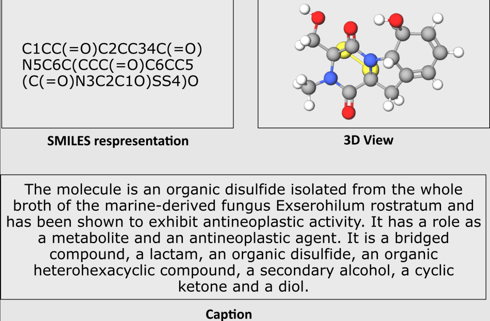

# Datasets
This directory contains multiple datasets comprising SMILES and text description pairs of chemical compounds. These datasets can be utilzied for a multitude of tasks like Molecule Captioning, Molecule Generation, and Property Prediction.

In this study, we have utilized the following datasets:
- [ChEBI20](./ChEBI20)
- [ChEMBL35](./ChEMBL35)
- [PubChemSTM](./PubChemSTM)
The individual details regarding each dataset can be found in their respective README files.
## Preprocessing
Each dataset contained SMILES strings of varying lengths along with corresponding textual descriptions in raw form. As part of our preprocessing pipeline, we filtered out SMILES strings longer than 256 characters, which accounted for less than 1% of the total samples in each dataset.

